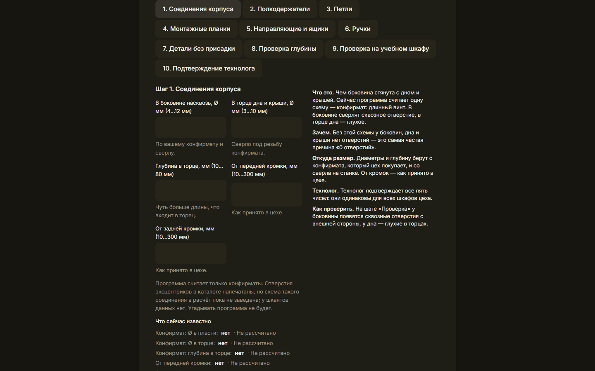
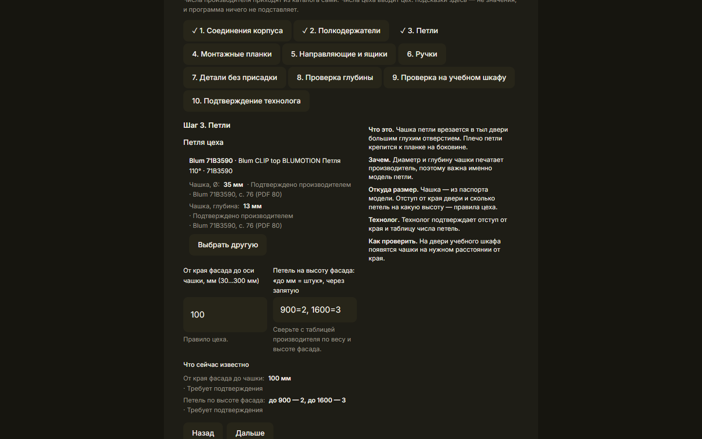
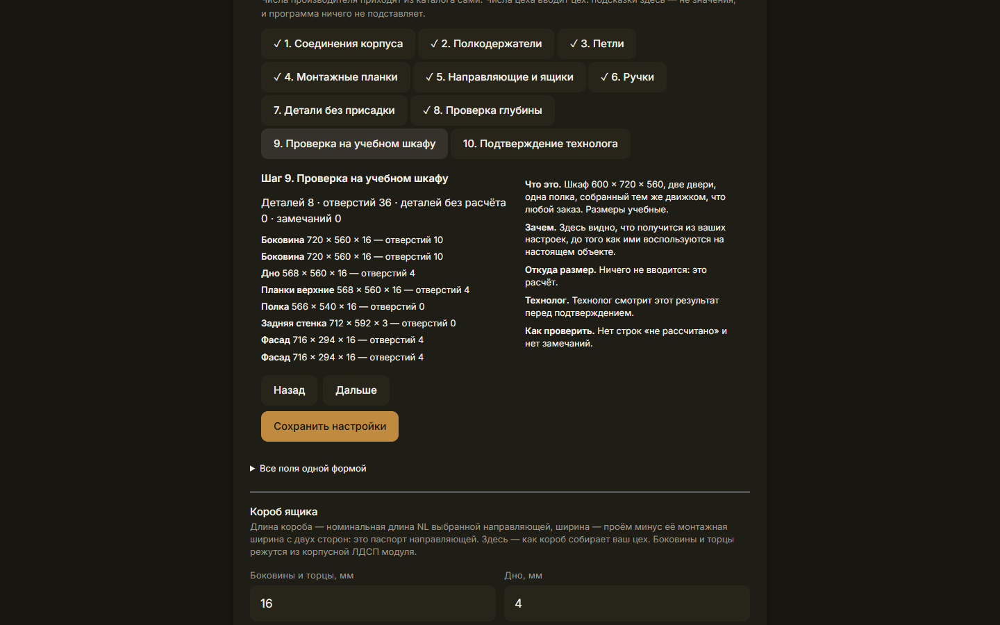
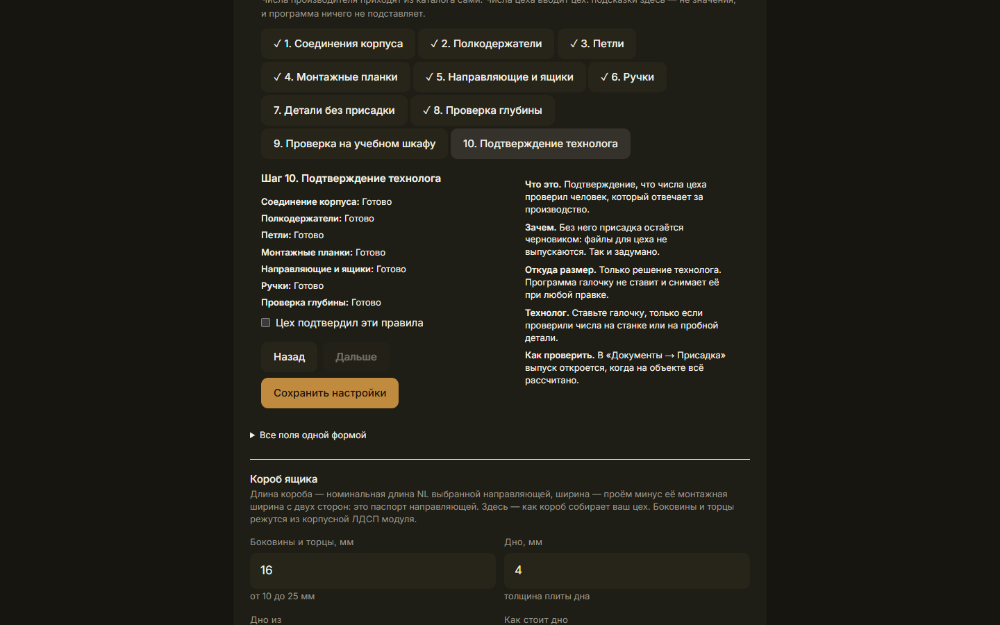
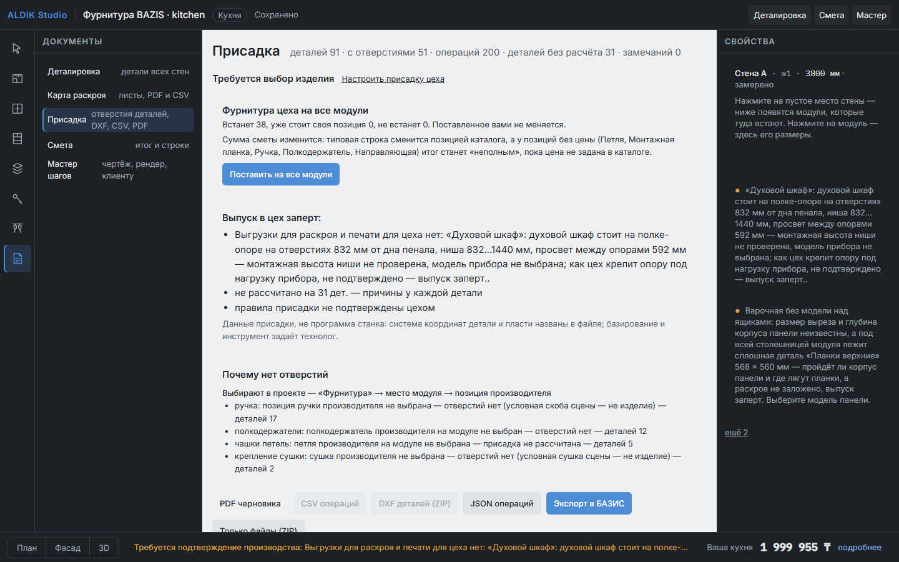
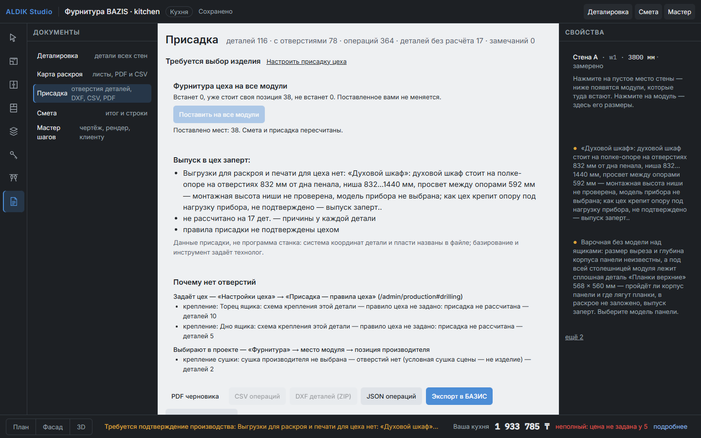
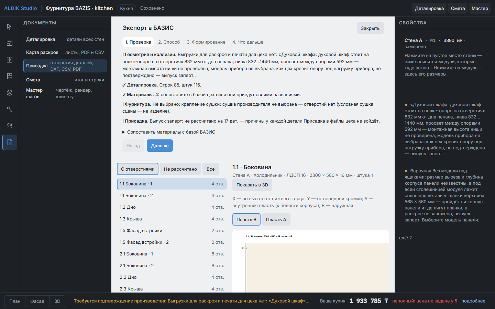
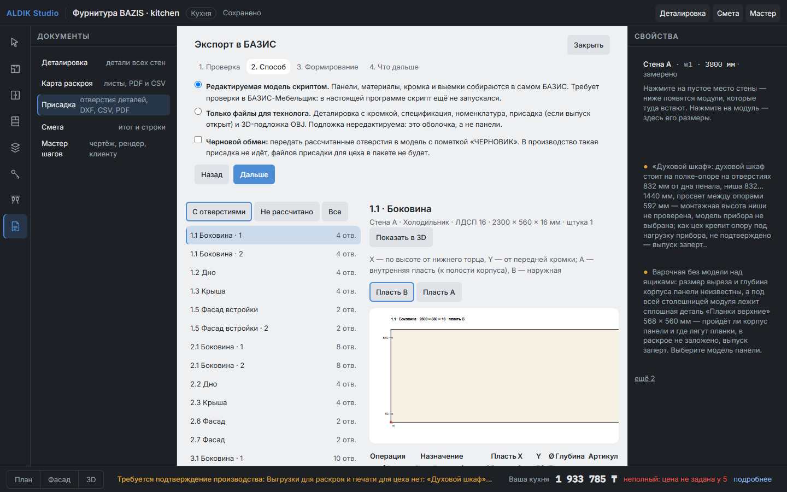
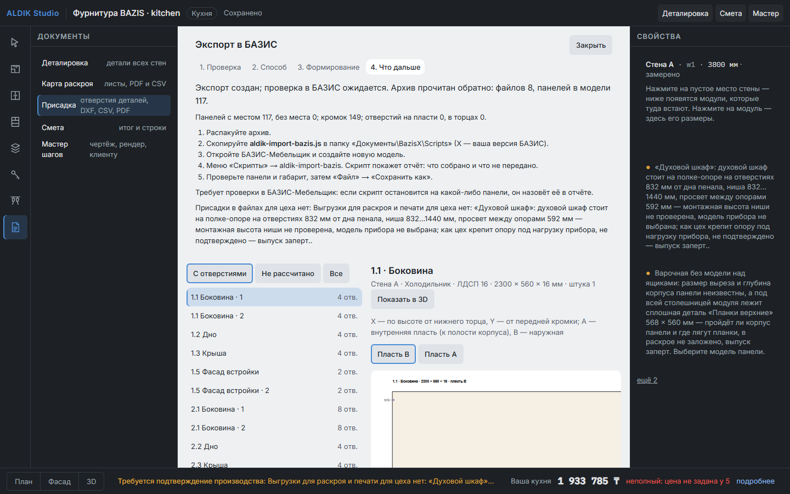

# ALDIK Studio → присадка → БАЗИС-Мебельщик. Руководство с нуля

Для человека, который не работал в БАЗИС и не делал присадку.

**Что важно знать сразу**

- Все снимки экрана здесь — настоящие снимки ALDIK Studio с проверенного прогона (временная организация).
- Снимков БАЗИС-Мебельщик здесь нет: программы на машине разработки нет. Шаги внутри БАЗИС взяты из его
  документации и **в настоящей программе не проверялись**. На экране это написано как «Требует проверки в
  БАЗИС-Мебельщик».
- Числа в примерах — учебные. Правила вашего цеха задаёт ваш технолог. Программа их не подставляет.

---

## 1. Слова, без которых не обойтись

Возьмём простой шкаф **600 × 720 × 560 мм**: две двери, одна полка. Ширина 600, высота 720, глубина 560.

| Слово | Что это простыми словами | Где на нашем шкафу |
|---|---|---|
| **Присадка** | Все отверстия в деталях, просверленные до сборки. Без них шкаф не собрать | 36 отверстий на 6 деталях |
| **Деталь** | Одна доска после распила | Боковина 720 × 560 × 16, дно 568 × 560 × 16 |
| **Пласть** | Большая плоская сторона детали. У детали их две: **A** и **B** | У боковины A смотрит внутрь шкафа, B — наружу |
| **Торец** | Узкая сторона детали, толщиной с плиту | Торец дна упирается в боковину |
| **Координаты X и Y** | Где отверстие на детали, в миллиметрах от угла. У каждой детали свои оси, они написаны рядом с ней | У боковины X — по высоте от низа, Y — от передней кромки |
| **Диаметр (Ø)** | Толщина сверла | Чашка петли Ø 35 |
| **Глубина** | На сколько сверло входит в деталь | Чашка — 13 мм при толщине 16 |
| **Глухое отверстие** | Не проходит деталь насквозь | Чашка петли: под ней остаётся 3 мм |
| **Сквозное отверстие** | Проходит насквозь | Отверстие под конфирмат в боковине |
| **Конфирмат** | Длинный винт, который стягивает две детали. В боковине — сквозное отверстие, в торце дна — глухое | 8 отверстий в боковинах, 8 в торцах дна и верхних планок |
| **Эксцентриковая стяжка** | Крепёж, невидимый снаружи: круглая «бочка» в одной детали и штифт в другой | Программа её пока не считает (см. раздел 8) |
| **Шкант** | Деревянный штырёк: держит детали ровно, но не стягивает | Программа его пока не считает |
| **Полкодержатель** | Штырёк, на котором лежит съёмная полка | 4 отверстия: по 2 на боковину |
| **Чашка петли** | Круглая часть петли, утопленная в тыл двери | Две на каждой двери |
| **Установка петли** | Сама петля + планка + их положение: отступ от кромки двери и высота | 100 мм от верха и от низа двери в примере |
| **Монтажная планка** | Ответная часть петли, крепится к боковине. В неё защёлкивается плечо петли | 2 планки на сторону, 2 отверстия у каждой |

### Откуда какие числа

Это главное, что нужно запомнить. Числа бывают трёх видов, и они не смешиваются:

1. **Подтверждено производителем.** Напечатано в каталоге: Ø и глубина чашки, межосевое ручки, цепочка
   направляющей. Приезжает само, когда вы выбрали артикул. Поправить нельзя.
2. **Подтверждено цехом.** Решение вашего цеха: отступ чашки от края двери, схема конфирматов. Вводится руками
   один раз и работает на всех объектах.
3. **Не рассчитано.** Числа нет ни у производителя, ни у цеха. Отверстие не ставится, и программа пишет почему.

Пока не стоит галочка «Цех подтвердил эти правила», числа цеха показываются как **«Требует подтверждения»**, а файлы
для производства не выпускаются.

---

## 2. Почему было «128 деталей, 0 отверстий»

Программа не сломана. Она отказалась выдумывать числа. Причин было две, и обе закрываются настройкой:

| Что было написано | Что это значит | Кто закрывает |
|---|---|---|
| Схема конфирматов — правило цеха не задано | В цехе не записано, как стягивается корпус | Шаг 1 мастера |
| Полкодержатель не выбран | Не выбрана модель, а значит, нет диаметра | Шаг 2 мастера |
| Петля производителя не выбрана | Условная петля на экране — не изделие | Шаг 3 мастера, затем «Поставить на все модули» |
| Позиция ручки не выбрана | То же про ручку | Шаг 6 мастера, затем «Поставить на все модули» |

Цифры «58 + 26 + 15 + 11 = 110» считали **причины**, а не детали: у одной боковины их бывает четыре. Сейчас на экране
написано «деталей без расчёта», и это число деталей.

В этой работе нашлись и настоящие недоработки, они исправлены:

- для полкодержателей не было места выбора: выбрать его в интерфейсе было нельзя;
- «Планки верхние» оставались без отверстий молча;
- у направляющих в паспорте напечатан винт, а не сверло, и задать сверло было негде;
- фурнитуру приходилось ставить на каждое место каждого модуля отдельно.

---

## 3. Настройка один раз: «Настроить присадку цеха»

**Где:** Настройки цеха (`/admin/production`) → блок «Присадка — правила цеха» → «Настроить присадку цеха».
Попасть туда можно и из «Документы → Присадка» по ссылке «Настроить присадку цеха».

Справа на каждом шаге пять подсказок: что это, зачем, откуда размер, что подтверждает технолог, как проверить.
Вверху — состояние: «Требуется выбор изделия», «Требуется правило цеха», «Требуется подтверждение», «Готово» или
«Обнаружена конструкционная ошибка».

Перед началом загрузите каталог: «Каталог» → «Фурнитура производителей» → «Загрузить». Без него выбирать не из чего.

| Шаг | Что делаете | Что программа подставит сама | Что введёт цех |
|---|---|---|---|
| 1. Соединения корпуса | Вводите схему конфирматов | Ничего | Ø в боковине, Ø в торце, глубина в торце, отступы от передней и задней кромки |
| 2. Полкодержатели | Выбираете модель | Ø и глубину | Оси от передней и задней кромки |
| 3. Петли | Выбираете модель | Ø и глубину чашки | Отступ от края фасада, таблицу числа петель |
| 4. Монтажные планки | Выбираете планку | Межосевое, отступ, TB по таблице наложения | Галочку «Ось планки — на высоте оси чашки» |
| 5. Направляющие и ящики | Выбираете направляющую | Цепочку отверстий | Сверло под винт и глубину, правила короба («Короб ящика» ниже на странице) |
| 6. Ручки | Выбираете модель | Межосевое | Сверло под винт, согласие с местом ручки |
| 7. Детали без присадки | Отмечаете то, что цех крепит саморезами по месту | Ничего | Только отметки |
| 8. Проверка глубины | Вводите минимальный остаток | Ничего | Число |
| 9. Проверка на учебном шкафу | Смотрите результат | Весь расчёт | Ничего |
| 10. Подтверждение технолога | Ставите галочку | Ничего и никогда | Галочку |

Поле поиска ищет по артикулу, производителю и серии. Галочка «Только с полными размерами для присадки» убирает позиции,
по которым отверстие посчитать нельзя. Например, у петли Blum 71B3550 положение саморезов чашки в паспорте не
образмерено: посчитать чашку можно, а выпуск останется заперт. У 71B3590 такой проблемы нет.

**Шаг 9 — самый полезный.** Программа собирает учебный шкаф тем же движком, что настоящий заказ, и показывает
результат ваших настроек:

Галочка на последнем шаге недоступна, пока не закрыты все шаги. Любая правка снимает её: технолог смотрит заново.

Нажмите **«Сохранить настройки»**. Настройка делается один раз на цех.

---

## 4. Каждый новый объект: две кнопки

1. **«Документы» → «Присадка».** Вверху блок «Фурнитура цеха на все модули». Он заранее пишет: сколько мест встанет,
   сколько уже занято вашими позициями, что не встанет и почему.

   

2. **«Поставить на все модули».** Позиции встают на пустые места. Поставленное вами не меняется. Смета и присадка
   пересчитываются сразу.

   

Координаты каждого отверстия вручную вводить не нужно: при смене размера, высоты фасада или модели петли они
считаются заново.

Слева — список деталей, справа — выбранная деталь: пласть A, пласть B, торцы, таблица отверстий с источником
каждого числа. Кнопка «Показать в 3D» подсвечивает деталь в сцене.

Что делать с тем, что осталось в блоке «Почему нет отверстий»:

- **Задаёт цех** — вернитесь в мастер.
- **Выбирают в проекте** — поставьте позицию на этом месте («Фурнитура»).
- **Производитель не напечатал** — отверстие не ставится. Возьмите другую модель или запросите чертёж.

---

## 5. Разбор примера: шкаф 600 × 720 × 560

Учебные значения: конфирмат Ø 7 в боковине, Ø 5 × 50 в торце, 50 мм от кромок; полкодержатель BOYARD P101Zn.56
(Ø 5 × 8, напечатано), оси 37 мм от кромок; петля Blum 71B3590 с планкой 173L8130; чашка 100 мм от края; ручка Häfele
115.52.630; остаток 3 мм. Все эти числа считает движок, результат ниже — из настоящего прогона.

**Боковина 720 × 560 × 16** (X — от низа, Y — от передней кромки; A — внутрь шкафа), 10 отверстий:

| Что | Пласть | X | Y | Ø | Глубина | Откуда |
|---|---|---|---|---|---|---|
| Планка петли | A | 86 и 118 | 37 | 5 | 11.5 | производитель; ось на чашке — цех |
| Планка петли | A | 602 и 634 | 37 | 5 | 11.5 | то же |
| Полкодержатель | A | 352 | 37 и 523 | 5 | 8 | Ø и глубина — производитель, оси — цех |
| Конфирмат | B | 8 | 50 и 510 | 7 | насквозь | цех |
| Конфирмат | B | 712 | 50 и 510 | 7 | насквозь | цех |

Проверим Y = 523: ширина боковины 560, ось 37 мм от задней кромки. 560 − 37 = 523. Сходится.

**Дно и верхние планки 568 × 560 × 16**: по 4 отверстия Ø 5 × 50 в торцах, Y = 50 и 510.

**Фасад 716 × 294 × 16** (X — от низа, Y — от левой кромки; B — тыл):

| Что | Пласть | X | Y | Ø | Глубина |
|---|---|---|---|---|---|
| Чашка петли | B | 100 и 616 | 21.5 | 35 | 13 |
| Ручка | B | 278 и 438 | 258.7 | 5 | насквозь |

Проверим чашку: высота двери 716, отступ 100, значит 100 и 716 − 100 = 616. Сходится. Глубина 13 при толщине 16
оставляет 3 мм — ровно минимум из примера. Межосевое ручки: 438 − 278 = 160 мм, как напечатано.

**Полка и задняя стенка** отверстий не имеют: полка лежит на полкодержателях, задняя стенка стоит в пазу или на скобах.

Итог: **8 деталей, 36 отверстий, деталей без расчёта 0, замечаний 0.**

---

## 6. Экспорт в БАЗИС

«Документы» → «Присадка» → **«Экспорт в БАЗИС»**. Четыре шага.

**Шаг 1. Проверка.** Геометрия, деталировка, материалы, фурнитура, присадка. Здесь же можно сопоставить материалы с
базой БАЗИС вашего цеха. Пустое поле значит, что материал приедет своим названием. Подмены без вас нет.

**Шаг 2. Способ.**

- **Редактируемая модель скриптом** — панели, материалы, кромка и выемки собираются в самом БАЗИС.
- **Только файлы для технолога** — деталировка, спецификация, номенклатура, присадка, 3D-подложка OBJ. Подложка
  нередактируема: это оболочка, а не панели.

Если выпуск заперт, неподтверждённой присадки в файлах для цеха не будет. Галочка «Черновой обмен» передаёт рассчитанные
отверстия только в модель и только с пометкой «ЧЕРНОВИК». В производство такая присадка не идёт.

**Шаг 3. Формирование.** «Сформировать пакет». Программа читает готовый архив обратно и пишет, что в нём реально лежит.

**Шаг 4. Что дальше.** Инструкция прямо на экране.

### Что в архиве

| Файл | Что это |
|---|---|
| `aldik-import-bazis.js` | Скрипт: панели, материалы, кромка, выемки. Данные объекта уже внутри |
| `aldik-model.json` | Те же данные для проверки. В БАЗИС не загружается |
| `parts.csv` | Детали с кромкой, для раскроя |
| `hardware.csv` | Спецификация фурнитуры |
| `nomenclature.xml` | Номенклатура для базы материалов |
| `drilling.csv`, `drilling.json`, `dxf/` | Присадка. Только при открытом выпуске |
| `model.obj` | 3D-подложка, нередактируемая |
| `manifest.json`, `README.txt` | Что в пакете, чего нет и почему |

Файла `.b3d` в архиве нет и не будет: формат закрыт. Модель создаёт сама программа БАЗИС, она же сохраняет её в свой
формат.

### Как открыть в БАЗИС-Мебельщик

> Требует проверки в БАЗИС-Мебельщик. Шаги — по документации; настоящего запуска ещё не было.

1. Распакуйте архив.
2. Скопируйте `aldik-import-bazis.js` в папку `Документы\BazisX\Scripts` (X — номер вашей версии).
3. Откройте БАЗИС-Мебельщик и создайте новую модель.
4. Откройте раздел главного меню **«Скрипты»** и выберите `aldik-import-bazis`.
5. Скрипт покажет отчёт: сколько панелей собрано, что не передано, какие материалы приехали без сопоставления.
6. Сверьте габарит и несколько панелей с ALDIK Studio.
7. Сохраните: «Файл» → «Сохранить как».

### Что будет и чего не будет в БАЗИС

| Что | Как приезжает |
|---|---|
| Панели | Настоящие панели БАЗИС, по блоку на модуль |
| Материал и толщина | Заданы панели; названия — ваши или ALDIK |
| Кромка | На своей стороне контура |
| Глухое отверстие на пласти | Круглая выемка, а не отверстие фурнитуры |
| Сквозное отверстие на пласти | Вырез контура панели |
| Отверстие в торце | Не передаётся. Оно в `drilling.csv` и названо в отчёте |
| Настоящая фурнитура БАЗИС | Нет. Ставит технолог из своей базы |

Почему так: у БАЗИС нет описанной команды «добавить отверстие в панель». Его отверстия появляются, когда в модели
установлена фурнитура. Поэтому для станка главный документ — присадка из ALDIK Studio, а модель в БАЗИС нужна для
правки панелей и раскроя.

---

## 7. Практика: 12 шагов

Шкаф 600 × 720 × 560, две двери, одна полка. Шаги 1–10 выполняются в ALDIK Studio, шаги 11–12 — в БАЗИС.

Шаги 1–3 — обычная сборка из библиотеки, проверенная на пустой стене. Именно стену 600 мм этим путём в браузере не
проходили: движок этот шкаф собирает (шаг «Проверка» мастера), а экран замера может попросить уточнений. Шаги 4–10
проверены в браузере на кухне временной организации: там мест больше, чем у учебного шкафа.

| № | Что сделать | Что вы должны увидеть |
|---|---|---|
| 1 | «Объекты» → новый объект. В замере стена 600 мм. На шаге решения — **«Собрать самому»** | Пустая стена, сумма 0 ₸ и пояснение, что мебели нет |
| 2 | Нажмите на пустое место на схеме. В библиотеке выберите карточку модуля шириной 600 мм | Модуль 600 в ряду |
| 3 | Выберите модуль, вариант **«Две дверцы»** | Две створки, шов посередине |
| 4 | Настройте цех по разделу 3, если ещё не настроено | В мастере статус «Готово» |
| 5 | «Документы» → «Присадка» | Блок «Фурнитура цеха на все модули»: встанет 4 |
| 6 | «Поставить на все модули» | Появились отверстия; «встанет» стало 0 |
| 7 | В списке нажмите «Боковина» | Пласти A и B, 10 отверстий |
| 8 | Сверьте с разделом 5 | X, Y, Ø совпадают при ваших правилах с поправкой на ваши числа |
| 9 | «Показать в 3D» | Деталь подсвечена, отверстия на ней |
| 10 | «Экспорт в БАЗИС» → «Дальше» → «Дальше» → «Сформировать пакет» | «Архив прочитан обратно: файлов N, панелей в модели 8 + столешница, если она есть» |
| 11 | Запустите скрипт в БАЗИС (раздел 6) | Отчёт скрипта с числом панелей |
| 12 | Проверьте габарит 600 × 720 × 560 и сохраните | Файл модели БАЗИС на диске |

Первый запуск шагов 11–12 — это и есть проверка интеграции. Если скрипт остановится, он назовёт панель и причину.
Пришлите этот текст: по нему правится скрипт.

---

## 8. Шесть уроков

**Урок 1. Что такое присадка.** Всё, что сверлят до сборки. Разделы 1 и 5.

**Урок 2. Откуда числа.** Производитель, цех, «не рассчитано». Раздел 1, «Откуда какие числа».

**Урок 3. Настройка цеха.** Один раз, с технологом. Раздел 3.

**Урок 4. Проверка детали.** Откройте боковину, найдите одно отверстие, вычислите его сами от кромки, сравните с
таблицей. Если сошлось на трёх разных отверстиях, вы умеете читать присадку. Раздел 5.

**Урок 5. Экспорт.** Что в архиве и зачем. Раздел 6.

**Урок 6. БАЗИС.** Запуск скрипта, чтение отчёта, сохранение. Раздел 6.

---

## 9. Типичные ошибки

| Что видите | Причина | Что сделать |
|---|---|---|
| «0 отверстий» | Нет правил цеха или не выбрана фурнитура | Раздел 3, затем «Поставить на все модули» |
| «Комплект цеха не выбран» | Мастер не пройден | Раздел 3 |
| Список позиций пуст | Каталог не загружен | «Каталог» → «Фурнитура производителей» → «Загрузить» |
| «Положение саморезов чашки не образмерено» | Паспорт этой петли неполон | Другая модель, например 71B3590 |
| «TB не получается из таблицы наложения» | Планка не подходит к петле | Планка другого подъёма |
| Галочка цеха недоступна | Шаги не закрыты | На шаге подтверждения видно, какие |
| Галочка пропала | Вы что-то поправили | Так задумано: проверьте и поставьте снова |
| «Сверло под винт направляющей — правило цеха не задано» | Паспорт печатает винт | Шаг 5 мастера |
| «Схема крепления этой детали — правило цеха не задано» | Цех не сказал, как крепится деталь | Шаг 7 мастера, если крепится без присадки |
| Выпуск заперт при 0 причин | Нет галочки цеха или замок экрана | Читайте красный блок сверху |
| Отчёт: «Габарит не совпал» | Панель встала не там | Пришлите отчёт разработчику |
| Отчёт: «НЕ СОБРАЛАСЬ» | БАЗИС отказал на панели | Пришлите отчёт разработчику |

---

## 10. Что пока невозможно или не проверено

- **Запуск скрипта в настоящем БАЗИС не проверялся.** Он проверен на строгом подобии опубликованного API: вызов,
  которого нет в описании, там падает. Но подобие — не программа.
- **Эксцентриковые стяжки и шканты не считаются.** В каталоге есть отверстия эксцентриков, но схема соединения в
  расчёт не заведена.
- **Настоящие отверстия фурнитуры БАЗИС не ставятся.** Причина — в разделе 6.
- **Отверстия в торцах не передаются в модель БАЗИС**, они только в `drilling.csv`.
- **Сборка короба ящика из ЛДСП** не считается: цех либо отмечает детали короба на шаге 7, либо они останутся
  «не рассчитано».
- **Детали по дуге** приезжают прямоугольной заготовкой, контур — в деталировке ALDIK.
- **Программ для станка нет.** Базирование и инструмент задаёт технолог.
